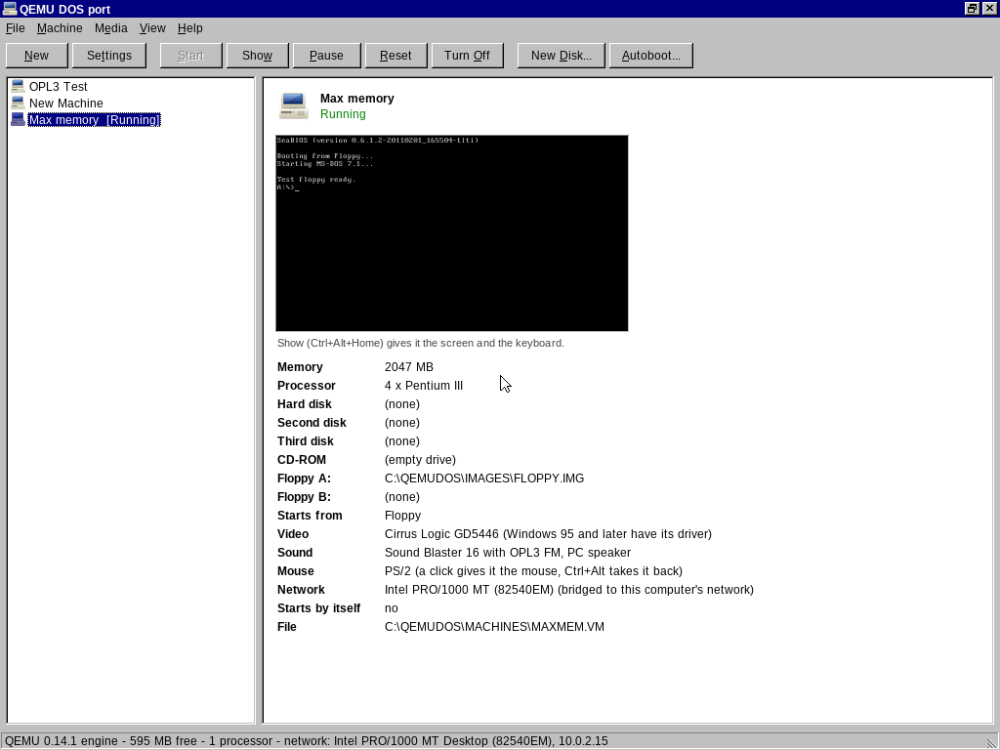
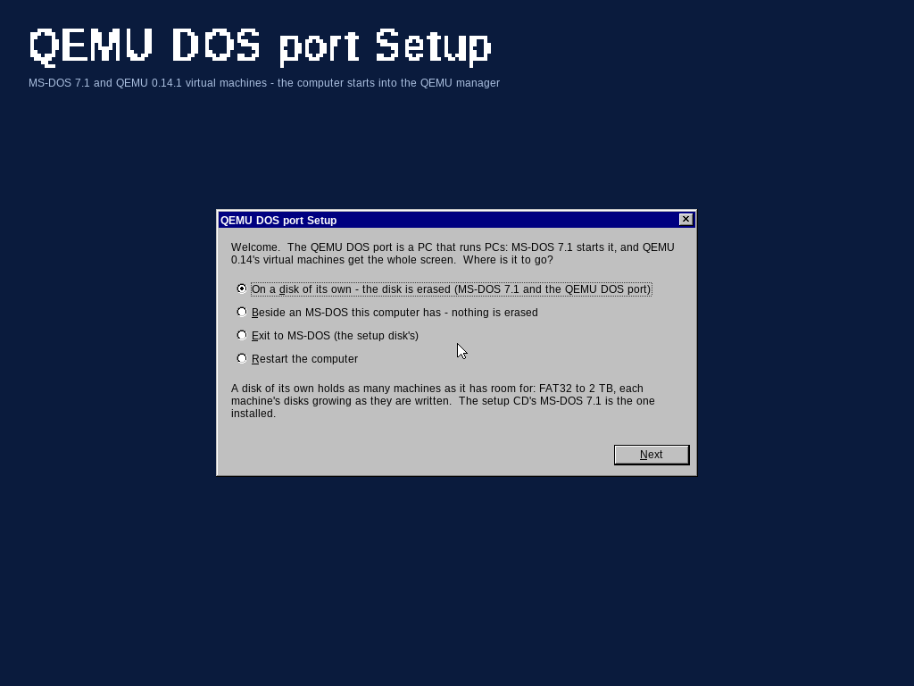

QEMU DOS port 1.0 - a PC that runs PCs
======================================

📸 Screenshots
*Click images to expand*

  
  

MS-DOS 7.1 starts the computer; the QEMU DOS port's 32-bit kernel (DOS95's,
with its drivers for today's disks, USB, sound and network cards) runs
QEMU 0.14.1 - the PC emulator - over the whole screen.  No desktop: the QEMU
manager is the one window, and a machine you start gets the screen.

INSTALL
  Boot the setup CD (QEMUDOS.ISO) or a USB stick made from SETUP.IMG.  The
  setup starts by itself:
   - On a disk of its own: the disk is erased, one FAT32 partition is made
     (as large as you ask - all of the disk up to 2 TB), MS-DOS 7.1 and the
     QEMU DOS port go on it, and the PC starts straight into the manager.
   - Beside an MS-DOS you have: copied to a folder (\QEMUDOS), nothing
     formatted; a line in AUTOEXEC.BAT if you want it to start by itself.
  It needs: MS-DOS 7.1 (on the setup disk), HIMEM.SYS, no EMM386; a Pentium
  or better.  A PC with UEFI only starts it through DOS95's BIOS layer
  (\EFI\BOOT\BOOTX64.EFI; Secure Boot off).

THE MANAGER
  New: a machine - its memory (to 2047 MB), processors (to 8), disks, CD and
  floppy images, video, sound, network card.  New Disk: an empty disk image -
  "grows as it is written" (any size to 2 TB, in 512 MB pieces beside a small
  .IMG file) or one fixed file (to 4095 MB, FAT32's largest file).
  Sound: a Sound Blaster 16 with its OPL3 FM synthesizer (the DOS games'
  music) and the PC speaker, through this computer's sound card.
  Start: the machine gets the whole screen.  Turn it off (or let it shut
  down) and start it, or another, again - as often as you like.  If QEMU
  cannot run a machine (a file it needs, an option it does not know), the
  manager says what QEMU said.  Autoboot: a machine started when the QEMU DOS
  port starts, after a countdown Esc stops; what happens when it shuts down.
  Each machine has its own network card address (Settings > Network).
  File > Exit to MS-DOS.

KEYS (while a machine has the screen every other key is the machine's,
Ctrl+Alt+Del, Alt+Tab and Alt+F4 too)
  Ctrl+Alt+Home   the QEMU manager - and from it, the machine again
  Ctrl+Alt+End    Ctrl+Alt+Del to the machine
  Ctrl+Alt        the mouse back from the machine
  Ctrl+Alt+S      the machine's picture: fitted, stretched, pixel for pixel

FROM DOS
  QEMUDOS            the manager (and the autoboot, if one is set)
  QEMUDOS /M name    that machine at once (a batch file of your own can be
                     the boot script)
  QEMUDOS /NOAUTO    the manager, no autoboot
  QEMUDOS /SETUP     the setup

LIMITS
  One machine runs at a time (QEMU 0.14's state is global); one after
  another is fine.  A machine's
  memory is at most 2047 MB (QEMU 0.14 on a 32-bit system); the QEMU DOS port
  uses the memory below 3 GB.  QEMU 0.14 emulates 32-bit PCs (486 to Pentium
  III, Core Duo, Athlon) with its translator - no VT-x.  Its guests: DOS,
  Windows 3.1, 95, 98, ME, NT 4, 2000, XP, Linux of their time (tested here:
  MS-DOS 7.1).  No network boot ROMs (QEMU says "pxe-....bin" - harmless).

QEMU is free software under the GNU GPL v2 (its source: qemu\ in the QEMU DOS
port's source).
